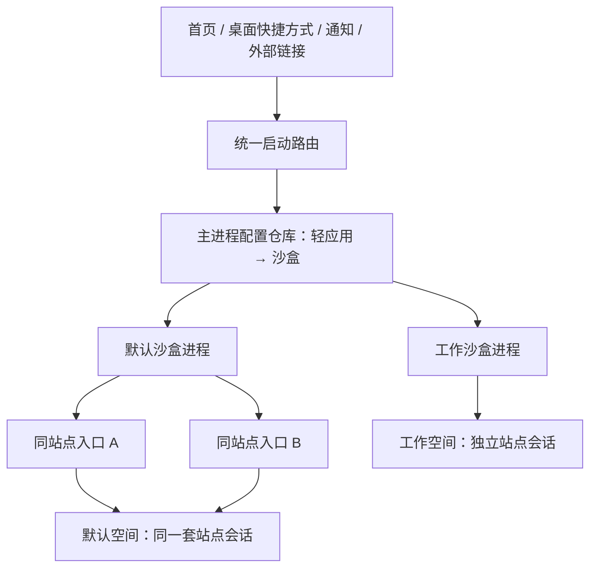

# 轻应用整体交互与沙盒重整方案

日期：2026-10-19（America/New_York）  
审计基线：当前项目 `609669f`；对照本机 Native Alpha 原版与 Hermit 解包材料。  
本轮交付：分析、交互契约、实施顺序和验收条件；未修改应用代码或重新发布安装包。

## 1. 核心判断

目前的问题同时存在于产品模型、界面入口、跨进程配置和网页运行时。只调整首页、颜色或设置排版，无法解决轻应用使用不稳定的问题。

应先确立一个统一模型：**轻应用定义网站和独立偏好；沙盒定义一组浏览会话与网站数据；显示模式只决定界面显示方式。** 同一沙盒中的同站点入口应使用同一会话；不同沙盒应隔离；全屏、普通和无框模式都应能完成相同的核心操作。

“同沙盒共享账号”有明确边界：同站点会话共享；跨站登录取决于站点自身的 SSO、跳转和 Cookie 策略，不能让互不相关的网站直接读取对方数据。这与 [Hermit 官方的沙盒说明](https://hermit.chimbori.com/features/sandbox)一致。

Cookie 仍遵守域、路径和属性规则；LocalStorage、IndexedDB 等遵守源隔离；sessionStorage 保持浏览窗口语义。共享沙盒不会让这些 Web 平台边界失效。

## 2. 审计范围与证据强度

- 当前项目：`/Users/grangerfdad/Desktop/NativeAlphaForAndroid-dev`。
- 原版：`/Users/grangerfdad/Desktop/NativeAlphaForAndroid-orignal`。
- Hermit：`/Users/grangerfdad/Desktop/hermit broswer` 的资源、反编译材料；辅以 Hermit 官方帮助核对语义。
- 按 `app/src/main` 全量文件内容比对：原版 129 个文件，当前 215 个；53 个相同、64 个修改、98 个新增、12 个移除。包括资源、资产和生成的 Activity 副本；这个统计代表改动范围，不代表发现了相同数量的问题。
- 使用 Magpie 路由 `group/auto-gpt-6-1-sol` 分三路审查：原版交互基线、Hermit 设置组织、当前导航及显示模式；主代理检查沙盒、配置同步和分发包。
- **代码确认**：调用链、布局、配置粒度和 APK 中可直接核实的行为。
- **运行风险**：根据平台契约推导的故障路径，需要设备复现来确认触发条件和影响程度。
- **未验证**：具体网站账号、OEM 手势、键盘遮挡像素、OAuth 回调等真实设备行为。

本轮执行 `adb devices -l`，没有连接设备；SDK 中未找到 emulator 可执行文件。没有把既有 Robolectric 通过记录当作真实 WebView 登录共享的验证结果。

全量文件分类、普通模式关键布局属性及 APK SHA256 另存于 [对比证据 JSON](/Users/grangerfdad/Desktop/NativeAlphaForAndroid-dev/design/interaction-audit/FILE-COMPARISON-AND-EVIDENCE.json)。文件内容相同并不意味着运行行为不受其他模块改动影响。

## 3. 已确认的关键问题

| 编号 | 优先级 | 证据和原因 | 用户影响与处理方向 |
|---|---|---|---|
| A01 | P0 | 旧实现的 WebView 目录后缀是 `containerId + alphanumericBaseUrl + "_" + appId`；最新提交改为进程固定的 `sandbox_N`，但未找到旧目录迁移实现。见 [原版目录绑定][original-profile]、[当前绑定][current-profile]。 | 旧版本同编号沙盒仍按轻应用分数据；新版本可能呈现为首次登录。修复共享语义时必须同时设计升级与冲突处理。 |
| A02 | P0 | 沙盒分别运行在独立进程，所有进程仍读取同一个 `MODE_PRIVATE` SharedPreferences，并把整份网站列表 JSON `apply()` 回去。见 [读取/保存][preferences]、[快捷设置写入][quick-save]。 | 旧配置快照、切换后回弹和整表覆盖风险。需要主进程统一持有配置，沙盒通过 IPC 读取和提交字段级变更。 |
| A03 | P0 | 每个轻应用的启动和动态更新都调用 `CookieManager.getInstance().setAcceptCookie(appSetting)`。见 [启动策略][cookie-start]、[动态策略][cookie-dynamic]。 | 当前共享进程内，某个轻应用的 Cookie 开关会改变共享 CookieManager 的策略。把第一方 Cookie 策略提升为沙盒级；第三方 Cookie 是否按页面控制另行保留。 |
| A04 | P0 | 退出清 Cookie 在任意 Activity 的 `onDestroy()` 中执行 `removeAllCookies`，只判断全局开关。见 [销毁清理][cookie-clear]。 | 共享沙盒内销毁一个窗口就可能清掉其他轻应用会话；系统销毁也不等于用户退出。清理要是明确的站点/沙盒操作，不能绑在窗口销毁上。 |
| A05 | P0 | 切换容器或发现旧路由时使用 `ProcessPhoenix.triggerRebirth`。见 [启动器][rebirth]、[返回设置处理][resume-settings]。 | 固定目录后，同进程可有多个轻应用及媒体服务；进程重启会影响整个原沙盒。普通切换应启动目标进程里的新窗口，再关闭当前窗口。 |
| A06 | P1 | 完整设置里只有“启用沙盒”，从无沙盒开启时调用轮转分配；具体沙盒选择在首页项目菜单另开 SandboxActivity。设置顶部标记只是 TextView。见 [开关][sandbox-switch]、[自动分配][auto-assign]、[另一个入口][separate-entry]。 | 用户无法在当前设置中自然地选择指定沙盒；不同入口含义不一致。替换成始终可见的“当前沙盒：个人/工作 ▾”选择行。 |
| A07 | P1 | `isFrameless || isShowFullscreen` 同时用于隐藏工具栏和隐藏系统栏。见 [工具栏状态][chrome-state]、[系统栏状态][bars-state]。 | “无框”和“全屏”失去独立语义；必须拆成两个状态，网页媒体全屏再单独处理。普通模式的具体遮挡原因需结合布局结论与设备验证。 |
| A08 | P1 | 现有 ImmersiveBrowserTest 的主点击/抽屉测试只执行 `(fullscreen=true, frameless=false)` 和 `(false,true)`；末尾切回普通模式只检查工具栏可见与手势排除区清空。SandboxUiTest 的同沙盒新增测试只检查 Java Set 中能登记两个 ID。见 [显示测试][immersive-test]、[普通模式浅检查][ordinary-test]、[沙盒测试][sandbox-test]。 | 现有测试没有覆盖用户指出的普通模式网页避让与点击，也没有证明 Chromium Cookie、LocalStorage 或 IndexedDB 的共享/隔离。补行为验收，再谈修复通过。 |
| A09 | P1 | `dist` 中多个不同安装包沿用 1.5.2。实际反编译确认旧 `final-debug` 的 App 没有固定沙盒目录初始化，最新 `standard` 已有。见 [旧包证据][old-apk]、[新包证据][new-apk]。 | 包名中的 final 不能代表当前修复。发布记录需包含 flavor、versionCode、提交、构建时间和 SHA256；不能只让用户凭 1.5.2 识别。 |
| A10 | P1 | 网页监控使用 Jsoup GET，未接入该轻应用的 WebView Cookie、沙盒和脚本环境。见 [监控请求][monitor]。 | 当前应明确为公开静态页面监控；不能让用户理解为“监控我登录后看到的页面”。登录态监控需另行设计并验收。 |
| A11 | P0 | 普通模式显示工具栏，但 `browserWebContent` 始终四边约束到父布局，WebView 铺满其中；工具栏是带 elevation 的兄弟视图。移动工具栏时也没有调整网页约束。见 [内容范围][web-content]、[覆盖层][toolbar-overlay]、[工具栏定位][toolbar-position]。 | 工具栏实际叠在网页上，能遮挡顶部/底部按钮；全屏隐藏工具栏后遮挡消失。应首先让普通模式网页区域避让工具栏。这能解释一类用户现象，具体站点仍需设备复现。 |
| A12 | P1 | 媒体 `onHideCustomView()` 调用 `showSystemBars()`，后者只看 `showFullscreen`；Back 没有先检查媒体 custom view。见 [媒体恢复][media-restore]、[系统栏恢复][bars-restore]、[返回处理][back-action]。 | 无框开、全屏关时，退出视频后可能恢复出不一致的系统栏；Back 缺少先退出媒体全屏的明确分支。建立临时媒体状态并统一恢复进入前状态。 |
| A13 | P1 | `openUrlExternal=true` 且 `allowAppLaunch=false` 时，跨站 HTTP(S) 链接既不内部加载，也不外跳，直接 `return true`。见 [外链分支][external-links]。 | 用户点击没有反馈。拆分“网页外链策略”和“允许启动外部应用”，阻止时解释原因，或按明确规则回退内部打开。 |
| A14 | P1 | 设置要求重载时调用 `reloadCurrentPage()`，但该函数在加载中只会 stopLoading 后返回。见 [刷新/停止][reload-toggle]、[设置返回][resume-settings]。 | 新 UA、请求头或脚本等配置没有被要求的新加载应用。将按钮的刷新/停止命令与设置触发的强制重载分开。 |

Android 官方明确说明 [SharedPreferences 不支持跨进程使用](https://developer.android.com/reference/android/content/SharedPreferences)。因此多调用一次 `loadAppData()` 或改 `apply()` 为 `commit()`，都不能代替跨进程配置协议。设置编辑结果通过 Intent 回传只能覆盖该次直接返回路径，不能解决首页改配置、并行窗口或多个沙盒同时编辑。

`setDataDirectorySuffix` 是**进程级初始化配置**，必须在使用 WebView 之前调用；不同进程不能直接共用一个数据目录。见 [Android WebView 文档](https://developer.android.com/reference/android/webkit/WebView#setDataDirectorySuffix(java.lang.String))。当前按沙盒固定后缀的方向正确，不能再把 appId 放回去，也不能用跨沙盒复制 Cookie 代替隔离。

## 4. 正确的对象关系与责任

| 对象 | 持有内容 | 不应承担的责任 |
|---|---|---|
| 轻应用 LiteApp | 稳定 appId、名称、图标、入口 URL、sandboxId、页面与权限偏好 | 不以 appId 再拆一套沙盒登录数据 |
| 沙盒 SandboxProfile | 稳定 ID、名称/颜色、固定 storageKey、Cookie 基础策略、数据清理范围 | 不与某个轻应用一对一绑定；颜色不是存储键 |
| 页面会话 BrowserSession | appId、sandboxId、当前 URL、历史、待处理权限/文件选择、临时媒体全屏 | 不自行保存整份全局应用列表 |
| 应用界面 BrowserChrome | 工具栏、设置面板、系统栏/键盘边距、无框模式的恢复入口 | 不改变 Cookie、权限或导航能力 |
| 配置仓库 AppRepository | 由主进程统一事务读写，提供版本和变更通知 | 不让各进程各写旧的全量 JSON |

短期保留现有“默认进程＋8 个沙盒进程”的方式，先修交互与一致性；固定槽位可以作为实现细节。不要在这一轮同时更换浏览器内核或多套 Profile 技术，否则难以区分新旧问题。



建议增加 `LaunchRequest(appId, targetUrl, sandboxId, settingsRevision, source)`，所有首页、桌面快捷方式、通知、深链接和重开动作都走同一个启动路由。启动前从配置仓库读取最新绑定；发现路由过期时重新分发，不重启整个原进程。未知或已删除的沙盒应显示可恢复错误，让用户选择处理，避免静默使用默认沙盒。

配置仓库的具体协议建议为：主进程通过内部 ContentProvider 或绑定服务提供 `read(appId)`、`update(appId, baseRevision, changedFields)` 和变更通知；底层数据库以事务提交。沙盒只提交当前变更的字段，冲突时重新读取并合并允许合并的字段，不覆盖未知的新值。设置返回 Intent 可作即时反馈，仓库版本才是最终依据。

## 5. 目标轻应用完整流程

### 5.1 创建

`输入网址 → 确认名称/图标和当前沙盒 → 在所选沙盒预览 → 保存轻应用 → 可选添加桌面快捷方式`。

- 默认选择“默认沙盒”，同时允许在同一个表单改成“个人”“工作”等已有沙盒；第一笔网页请求就使用所选空间。
- 提供“高级选项”，不要先要求用户理解进程、容器槽位或专家模式。
- 同一个网站允许创建多个入口，并清楚显示它们所在沙盒。
- 创建和单纯浏览的临时草稿应有明确差别；取消创建不留下半个首页条目。

### 5.2 启动和日常使用

`任意入口 → 按 appId 读取最新沙盒 → 正确进程/数据空间 → 应用有效设置 → 打开目标 URL或恢复页面 → 同一套导航和设置命令`。

- 同站点导航保留在当前会话；跨站导航遵守明确的打开策略。
- 第三方登录跳转保留发起轻应用与沙盒的上下文，完成后回到发起页面。
- 弹出窗口需要父子会话和 opener/关闭关系；不能简单吞掉新窗口，也不能一律交给外部浏览器。
- `mailto:`、`tel:`、`intent:` 等外部动作遵守当前站点授权；回来后保留页面、滚动和表单状态。
- 返回依次处理：临时层/媒体全屏、设置面板、网页历史、应用退出策略。不要在没有历史时先导航首页来制造一次额外加载。

### 5.3 设置和切换沙盒

```text
轻应用页面
  └─ 设置
      ├─ 当前沙盒：工作 ▾       ← 点击即可切换
      ├─ 页面显示与行为
      ├─ 网站权限
      ├─ 登录与网站数据
      └─ 更多设置
          ├─ 当前沙盒：工作 ▾   ← 相同组件、相同名称、相同操作
          ├─ 外观 / 行为 / 权限 / 数据
          └─ 高级
```

沙盒选择器显示：名称、颜色、当前选中状态、已关联轻应用数量；底部提供“管理沙盒”。首页的沙盒管理仍可保留，但只是管理入口，不能是切换当前应用的唯一途径。设置顶部的沙盒标记应可点击并带文字/展开指示。

必须区分两种动作：

| 动作 | 用户可见结果 | 是否更改长期绑定 |
|---|---|---|
| 更改此轻应用的默认沙盒 | 以后从所有入口打开都使用目标沙盒；当前窗口重开到目标空间 | 是 |
| 在另一沙盒临时打开 | 打开另一个会话，原轻应用默认绑定不变；两个窗口都标明空间 | 否；作为后续能力，第一阶段可不提供 |

更改默认沙盒采用一个明确的提交操作，例如“切换并重新打开”。目标空间使用它原有的登录状态；旧空间的数据继续保留。普通切换不移动或合并账号，不清旧空间，不要求用户理解“重启所有进程”。若存在未保存表单，只在确有丢失风险时提示。

### 5.4 显示模式

| 模式 | 系统栏 | 应用工具栏 | 设置/导航可达性 |
|---|---|---|---|
| 普通 | 显示 | 显示，可选择顶部/底部 | 可见按钮 |
| 全屏 | 隐藏，可由系统手势临时显示 | 由独立“隐藏工具栏”选项决定 | 可见按钮或可发现的恢复控件 |
| 无框 | 按全屏选项决定 | 隐藏 | 常驻、可操作且不遮挡网页主要按钮的恢复入口；手势仅作补充 |
| 网页媒体全屏 | 临时控制 | 临时隐藏 | 退出动作恢复进入前的完整状态 |

四种状态共用同一组命令：返回、前进、主页、刷新/停止、分享、网站权限、切换沙盒和更多设置。切换显示模式不能改变登录、上传、弹窗或网页按钮的可用性。

普通模式需要给 WebView 分配扣除工具栏后的真实可用区域；全屏需要正确处理系统栏、刘海和键盘 Insets。顶部和底部工具栏、横竖屏、手势/三键导航都必须验收。

## 6. 设置设计和生效规则

设置分成三个清晰层级：

1. **应用设置**：语言、主题、默认工具栏位置、默认新建偏好、导入导出。
2. **轻应用设置**：入口与图标、页面显示、JS/桌面模式/深色模式、站点权限、打开链接规则、脚本等。
3. **沙盒设置**：名称与颜色、共享会话说明、第一方 Cookie 基础策略、关联轻应用、站点数据与清理操作。

轻应用里可查看当前沙盒设置，也可在同一处切换；无需退回另一套管理页面。改变共享设置时清楚说明影响哪些轻应用。

逐项区分“继承默认值”和“本应用自定义”，避免只改一个快捷开关就将整份全局默认快照永久冻结成该应用设置。短期可以保留旧字段作兼容，但新交互不再暴露“启用沙盒→自动分配”的模型。

快捷面板开关即时生效；完整设置采用草稿和明确的保存/取消。完整设置的沙盒选择器只返回草稿选择，不自行写仓库；保存后才提交并重新打开。返回时没有变更直接退出，有变更才提示保存或放弃，避免界面有“保存/取消”而系统返回却悄悄保存。浏览页直接切换时，“切换并重新打开”本身就是提交动作。

| 变更 | 生效方式 |
|---|---|
| 名称、颜色、工具栏 | 即时更新界面，不重载页面 |
| 网页字体、可原地更新的显示偏好 | 原地应用，保持滚动与表单 |
| JS、UA、阻断规则等影响请求的选项 | 明确提示需要刷新，集中处理一次 |
| 默认沙盒 | 提交绑定后重新分发当前轻应用窗口 |
| 清理站点/沙盒数据 | 独立明确操作，显示范围；协调受影响会话再清理 |

“删除轻应用”“注销网站”“清理站点数据”“清空整个沙盒”必须是四个不同动作。删除一个入口不能默认注销同沙盒里的其他入口。

## 7. 实施顺序和完成门槛

| 阶段 | 工作包 | 完成门槛 |
|---|---|---|
| P0：恢复核心可靠性 | 普通模式网页避让工具栏；固定沙盒存储与升级策略；主进程配置仓库及 IPC；Cookie/清理粒度；去掉普通切换中的进程重生 | 网页按钮不被宿主遮挡；两个同站点轻应用共享登录、跨沙盒隔离、并行窗口不互相覆盖设置或被切换操作终止 |
| P1：统一交互 | 页面/完整设置共用沙盒选择器；模式状态拆分；工具栏和 Insets；统一返回、链接及设置生效规则 | 从轻应用页面能直接完成沙盒切换；普通模式与全屏核心能力一致；旧快捷方式自动使用新绑定 |
| P2：补齐网页兼容 | OAuth/新窗口、文件上传下载、权限回调、旋转与恢复、后台媒体 | 真实场景完成后可回到原页面；登录、媒体和待处理回调不丢失或越过沙盒 |
| P3：扩展与维护 | 监控能力边界、脚本、备份范围、生成代码和发布记录 | 功能说明与实际行为一致；每个发布包可追溯且不会混用旧包 |

这些阶段按依赖排序，不是可以并行一次性改完的清单。先固定模型与验收，再在同一模型上做界面调整。

代码可按职责逐步拆为 `LaunchRouter`、`AppRepository`、`SandboxRegistry`、`SettingsResolver`、`BrowserSessionController`、`BrowserChromeController` 和 `SitePermissionController`。先抽出状态与接口，避免第一轮同时大规模重写所有网页回调。

## 8. 升级与现有登录保护

固定后缀方案不能简单覆盖旧数据目录。旧实现允许同一个容器编号下多个 appId 各自拥有不同账号；把这些目录自动混成一个共享沙盒会存在账号冲突。

实施前先识别旧数据来源并保留原件。无冲突时也必须验证平台支持的迁移方式；有冲突时列出受影响轻应用，让用户决定保留哪个会话来源或分到不同沙盒。无法完整迁移的状态应明确说明需要重新登录，提供恢复路径。不要承诺通过复制几条 Cookie 就能完整保留 LocalStorage、IndexedDB、Service Worker 等状态，也不要在 WebView 正在使用时复制/合并 Chromium 数据库。

沙盒 `storageKey` 一经绑定不得因改名、换颜色或列表重排而改变。切换和升级是不同操作；切换不执行数据迁移。

## 9. 行为验收清单

以下是实施后的发布门槛，本轮未声称这些场景已经通过。

| 组别 | 必测场景 | 预期 |
|---|---|---|
| 登录共享 | 同站点两个入口，同一沙盒；冷启动/热启动/并行窗口 | 在站点 Cookie 和持久存储语义允许的范围内，使用相同会话；页面必要时刷新后反映登录变化 |
| 同源存储 | Cookie、LocalStorage、IndexedDB、Service Worker | 同源同沙盒共享，跨沙盒隔离；sessionStorage 按窗口语义独立 |
| 登录隔离 | 同站点，默认/沙盒0/沙盒1，各登录不同测试账号 | 互不覆盖 |
| 跨站登录 | OAuth 重定向、新窗口、外部 app 回调 | 保留发起方、沙盒与回调上下文；站点兼容问题与沙盒路由问题分别记录 |
| 配置并发 | 首页改 B 沙盒，A/B 窗口同时改快捷设置 | 字段变更不覆盖彼此；旧窗口不会重新写回旧沙盒绑定 |
| 切换 | A→B→A，默认↔彩色；旧桌面快捷方式重进 | 每次读取当前绑定；登录按各空间原状态保留 |
| 进程共存 | 同沙盒两个轻应用、其中一个播放媒体；切换另一个 | 未切换的窗口和媒体不被杀进程 |
| 清理范围 | 关窗口、删入口、清某站点、清某沙盒 | 只有明确操作和对应范围受影响 |
| 显示模式 | 普通/全屏/无框/媒体全屏；顶部/底部工具栏 | 同一功能集均可达，媒体退出恢复先前状态 |
| 屏幕与输入 | Android 28/30/35；横竖屏；键盘；刘海；手势/三键；大字体 | 工具栏与网页不重叠，输入框及提交按钮可达 |
| 网页交互 | 导航、网页底部按钮、拖动、长按、下拉刷新、返回 | 宿主不抢夺无关网页操作，返回顺序一致 |
| 文件和权限 | 图片/多文件选择、取消、摄像头/麦克风/定位，允许和拒绝 | 回调只完成一次，回到正确页面；授权按站点范围记录 |
| 下载 | 需要登录的下载、外链下载、用户取消 | 请求带正确沙盒会话，不借用其他沙盒 Cookie |
| 设置更新 | 保存/取消/返回、只改颜色、改 UA、改沙盒 | 按明确的生效规则执行，不意外丢掉表单 |
| 恢复 | 旋转、进程回收、应用重开、升级、配置导入 | 不使用错误沙盒；不静默合并账号；能解释无法恢复的临时状态 |
| 分发 | APK hash、flavor、commit、versionCode 与验收记录 | 用户安装的确实是验收对应包 |

优先搭建可控的 HTTPS 测试站点，提供同源登录、子域跳转、Cookie 属性、OAuth 模拟、新窗口、上传、媒体和固定底部按钮，避免用网站自身策略变化掩盖宿主问题。真实第三方站点作为兼容性补充。

## 10. 已核实的 APK 差异

| 文件 | SHA256 | App 初始化实现 |
|---|---|---|
| `dist/ShellAlpha-1.5.2-final-debug.apk` | `1c8b9e0396cdc59fc1613843c6b7993e3547a192d379e43d6e0c319b0525bfce` | 无按沙盒进程设置固定 suffix |
| `dist/ShellAlpha-v1.5.2-standard.apk` | `24fbabf1557d32bc6f446d494554e34722800f89eafaa0303cffe64bb5464ccc` | `:web_sandbox_N → sandbox_N` |

反编译证据保存在本目录 `apk-evidence/`，仅提取了本项目 App 类。无法据此判断用户手机安装了哪一个包，当前没有连接设备。

## 11. Hermit 值得移植的具体交互

| 对照点 | Hermit 本机证据 | 当前项目的落点 |
|---|---|---|
| 浏览现场知道当前沙盒，也能操作 | 浏览页为当前沙盒按钮设置图标和颜色并显示；点击处理在轻应用上下文打开选择器。见 [浏览页按钮][hermit-browser]、[点击路由][hermit-action]。 | 把已有色点/编号徽章变成带名称的可点击入口，复用一个选择器。 |
| 轻应用设置可直接选择空间 | 独立 SandboxPreference 显示当前名称和颜色。见 [沙盒偏好][hermit-preference]、[偏好布局][hermit-layout]。 | 在设置顶部放“当前沙盒：工作 ▾”，替代启用开关和隐式轮转分配。 |
| 选择和管理有不同目的 | 全局设置有沙盒管理入口，管理卡片容纳成员与数据操作。见 [全局入口][hermit-admin]、[管理卡片][hermit-card]。 | 选择器专注切换；管理页专注名称、成员、数据；不要求到管理页才能换当前空间。 |
| 全屏与无框分别配置 | 配置资源有两个独立选项。见 [显示配置][hermit-display]。 | 两个状态分别控制系统栏和应用工具栏；所有模式共用功能命令。 |
| 切换前说明生效方式 | 设置页进入 Apply Changes / Restart / Cancel 对话框。见 [变更对话框][hermit-apply]。 | 使用“切换并重新打开”，展示目标空间；只重新分发当前会话，不照搬全局进程重启。 |

这些证据来自资源及部分反编译控制流，支持入口组织和状态呈现的判断。Hermit 的部分点击回调没有成功反编译，不能把反编译器生成的异常当作产品真实崩溃，也不能据此声称 Hermit 如何迁移全部站点数据。此轮没有运行 Hermit。

应学习其会话模型和上下文连续性。旧版帮助要求用户清理最近任务等实现限制，不应成为当前项目的目标体验。当前项目已有默认＋8 个固定进程，暂不增加“无限沙盒”或“无痕关闭即销毁”的承诺。

## 12. 原版到当前的完整用户能力对照

原版可用作回归基线，但它原有的按轻应用独立数据目录，并不天然等于 Hermit 的共享沙盒模型。部分网页兼容限制原本就存在；在新目标下仍要修复，不能误报成此次新增回归。

| 能力 | 原版 → 当前 | 判断和优化落点 |
|---|---|---|
| 创建轻应用 | URL 表单与桌面快捷方式 → 保留，增加标题/图标提取和外部 URL 入口 | 当前“打开或创建”仍进入创建流程，没有优先匹配已有应用；改成已有入口解析或清楚标明创建。[创建代码][create-app] |
| 首页 | 列表、拖动/滑动操作 → 网格/列表、搜索和项目菜单 | 主要是入口迁移；删除、排序、设置、沙盒使用相同术语和同一个对象 ID。[项目菜单][separate-entry] |
| 桌面快捷方式 | 保留固定快捷方式，增强图标获取 | 仍以标题作 shortcut ID 的继承限制会让同名入口冲突；改为稳定 appId，重命名只改 label。[快捷方式][shortcut] |
| 启动与任务 | ID/URL 路由 → 增加路由修正；清单 `intoExisting` 改为 `always` | 多次打开是否产生重复任务需要产品决定。建议普通启动恢复该轻应用现有窗口，“新开窗口”才显式新建；所有入口读最新沙盒绑定。[当前清单][task-mode]、[原版清单][original-task] |
| 返回与历史 | 历史后退、回基址、再退后台 → 保留，新增抽屉优先和超时退出提示 | 当前退出仍是移到后台；应清楚区分关闭窗口与后台保留。统一媒体/面板/网页/退出的顺序。[返回处理][back-action] |
| 外链与新窗口 | 原有外跳 → 更准确的主机判断和外部应用开关 | 发现 A13；两份源码均未见完整新窗口处理。OAuth、支付和 `window.open` 必须作为专门会话流程验收，不能宣称已完整支持。[外链][external-links] |
| 网页偏好 | JS、DOM 存储、UA、缩放、HTTP 提示、自动刷新 → 保留，增加下拉刷新和追踪参数清理 | 保持普通和沉浸模式一致；“恢复页面”两版有字段，但未发现对应 WebView 状态保存/恢复路径，需明确 URL 恢复与完整状态恢复的差别。[模型][app-model]、[初始化][web-init] |
| 设置继承与保存 | 全局默认＋独立覆盖 → 保留，增加热更新和返回自动保存 | 自动保存是契约变化，当前又保留保存/取消按钮；采用本方案一致的草稿语义。修 A14，按字段区分原地生效/刷新/重开。[保存处理][settings-save] |
| 网站权限 | 定位、相机、麦克风、DRM → 基本继承 | 媒体 request 在异步授权结束前就 grant 当前列表，未保留原请求等待授权；属于原版已有的时序缺陷。要保留请求、按来源完成一次，再返回网页。[授权入口][media-permission]、[grant][permission-grant] |
| 文件上传 | 系统文件选择 → 基本继承 | 旧 callback 被新请求覆盖、启动失败没有完成回调、取消后引用未清，均为继承限制。取消、重复选择、旋转和拍照回程要专项验收。[文件选择][file-chooser] |
| 下载/PDF | DownloadManager、PDF 外跳 → 基本继承 | Blob 只剥前缀、Request 构造失败后的空值路径及无 PDF 处理器等问题原版已有。需要正确的下载方案和失败反馈；登录下载携带当前沙盒会话。[下载处理][downloads] |
| 广告拦截 | 过滤列表和请求拦截 → 保留，增加快捷开关 | 快捷广告开关同时修改 Safe Browsing，两种功能不应隐式联动；独立保存与生效，并验证启停和过滤列表刷新。[快捷开关][adblock-toggle] |
| 后台媒体 | 原版有选项但暂停路径仍停媒体 → 增加控制器、前台服务、通知操作 | 是新增运行能力；顶层媒体检测的边界不等于任意 iframe/WebAudio 后台播放。测试锁屏、移除任务、多应用共存、通知恢复和停止。[媒体控制器][background-media] |
| 网页监控 | 无 → Jsoup 页面文本哈希及周期任务 | 限公开静态内容；“立即检查”只同步周期任务，没有专门的一次性执行和结果回传，应补真实即时操作。通知权限也需从监控入口可达。[监控][monitor]、[立即检查按钮][monitor-now] |
| 用户脚本 | 无 → 页面完成后注入脚本 | 遇 `@grant/@require/@resource` 会跳过，不能按完整用户脚本管理器描述。先明确支持格式，再在当前沙盒/当前页面执行。[脚本实现][userscripts] |
| 备份与恢复 | Base64 Java 序列化配置 → JSON schema/checksum，兼容旧导入 | 改进的是配置导出；未见 Cookie、站点存储和图标文件的完整备份路径。界面写“配置备份”，不要承诺恢复全部账号与页面状态。[导出][backup] |

上述权限、文件选择、下载的故障路径是静态确认；是否在用户使用的网站上触发以及实际错误反馈，仍需设备验证。修复范围应纳入后续网页兼容阶段。

任务契约建议明确为：**同一 appId 的普通启动优先恢复已有窗口；不同 appId 可以并行共享同一个沙盒；只有“新开窗口”显式创建同 appId 的额外会话。** 不再用 `baseUrl + ID` 拼接作为长期身份，修改入口 URL 不应改变轻应用身份。

## 代码证据索引

[original-profile]: /Users/grangerfdad/Desktop/NativeAlphaForAndroid-orignal/app/src/main/java/com/cylonid/nativealpha/WebViewActivity.java:163
[current-profile]: /Users/grangerfdad/Desktop/NativeAlphaForAndroid-dev/app/src/main/java/com/cylonid/nativealpha/util/App.java:27
[preferences]: /Users/grangerfdad/Desktop/NativeAlphaForAndroid-dev/app/src/main/java/com/cylonid/nativealpha/model/DataManager.java:109
[quick-save]: /Users/grangerfdad/Desktop/NativeAlphaForAndroid-dev/app/src/main/java/com/cylonid/nativealpha/WebViewActivity.java:888
[cookie-start]: /Users/grangerfdad/Desktop/NativeAlphaForAndroid-dev/app/src/main/java/com/cylonid/nativealpha/WebViewActivity.java:280
[cookie-dynamic]: /Users/grangerfdad/Desktop/NativeAlphaForAndroid-dev/app/src/main/java/com/cylonid/nativealpha/WebViewActivity.java:922
[cookie-clear]: /Users/grangerfdad/Desktop/NativeAlphaForAndroid-dev/app/src/main/java/com/cylonid/nativealpha/WebViewActivity.java:1355
[rebirth]: /Users/grangerfdad/Desktop/NativeAlphaForAndroid-dev/app/src/main/java/com/cylonid/nativealpha/util/WebViewLauncher.kt:31
[resume-settings]: /Users/grangerfdad/Desktop/NativeAlphaForAndroid-dev/app/src/main/java/com/cylonid/nativealpha/WebViewActivity.java:1231
[sandbox-switch]: /Users/grangerfdad/Desktop/NativeAlphaForAndroid-dev/app/src/main/res/layout/webapp_settings.xml:747
[auto-assign]: /Users/grangerfdad/Desktop/NativeAlphaForAndroid-dev/app/src/main/kotlin/com/cylonid/nativealpha/model/WebApp.kt:307
[separate-entry]: /Users/grangerfdad/Desktop/NativeAlphaForAndroid-dev/app/src/main/kotlin/com/cylonid/nativealpha/fragments/webapplist/WebAppListAdapter.kt:282
[chrome-state]: /Users/grangerfdad/Desktop/NativeAlphaForAndroid-dev/app/src/main/java/com/cylonid/nativealpha/WebViewActivity.java:747
[bars-state]: /Users/grangerfdad/Desktop/NativeAlphaForAndroid-dev/app/src/main/java/com/cylonid/nativealpha/WebViewActivity.java:937
[immersive-test]: /Users/grangerfdad/Desktop/NativeAlphaForAndroid-dev/app/src/test/java/com/cylonid/nativealpha/ImmersiveBrowserTest.java:29
[ordinary-test]: /Users/grangerfdad/Desktop/NativeAlphaForAndroid-dev/app/src/test/java/com/cylonid/nativealpha/ImmersiveBrowserTest.java:97
[sandbox-test]: /Users/grangerfdad/Desktop/NativeAlphaForAndroid-dev/app/src/test/java/com/cylonid/nativealpha/SandboxUiTest.java:125
[monitor]: /Users/grangerfdad/Desktop/NativeAlphaForAndroid-dev/app/src/main/kotlin/com/cylonid/nativealpha/monitors/WebMonitorWorker.kt:41
[old-apk]: /Users/grangerfdad/Desktop/NativeAlphaForAndroid-dev/design/interaction-audit/apk-evidence/final-debug-App.java:13
[new-apk]: /Users/grangerfdad/Desktop/NativeAlphaForAndroid-dev/design/interaction-audit/apk-evidence/latest-standard-App.java:17
[web-content]: /Users/grangerfdad/Desktop/NativeAlphaForAndroid-dev/app/src/main/res/layout/full_webview.xml:18
[toolbar-overlay]: /Users/grangerfdad/Desktop/NativeAlphaForAndroid-dev/app/src/main/res/layout/full_webview.xml:66
[toolbar-position]: /Users/grangerfdad/Desktop/NativeAlphaForAndroid-dev/app/src/main/java/com/cylonid/nativealpha/WebViewActivity.java:731
[media-restore]: /Users/grangerfdad/Desktop/NativeAlphaForAndroid-dev/app/src/main/java/com/cylonid/nativealpha/WebViewActivity.java:1645
[bars-restore]: /Users/grangerfdad/Desktop/NativeAlphaForAndroid-dev/app/src/main/java/com/cylonid/nativealpha/WebViewActivity.java:1433
[back-action]: /Users/grangerfdad/Desktop/NativeAlphaForAndroid-dev/app/src/main/java/com/cylonid/nativealpha/WebViewActivity.java:1191
[hermit-browser]: </Users/grangerfdad/Desktop/hermit broswer/decompiled_hermit/sources/com/chimbori/hermitcrab/web/BrowserFragment.java:279>
[hermit-action]: </Users/grangerfdad/Desktop/hermit broswer/decompiled_hermit/sources/defpackage/xp.java:48>
[hermit-preference]: </Users/grangerfdad/Desktop/hermit broswer/decompiled_hermit/sources/com/chimbori/hermitcrab/sandbox/SandboxPreference.java:67>
[hermit-layout]: </Users/grangerfdad/Desktop/hermit broswer/apktool_out/res/layout/preference_sandbox.xml:6>
[hermit-admin]: </Users/grangerfdad/Desktop/hermit broswer/apktool_out/res/xml/settings_admin_main.xml:8>
[hermit-card]: </Users/grangerfdad/Desktop/hermit broswer/apktool_out/res/layout/item_sandbox_setting.xml:7>
[hermit-display]: </Users/grangerfdad/Desktop/hermit broswer/apktool_out/res/xml/settings_lite_app_behavior.xml:6>
[hermit-apply]: </Users/grangerfdad/Desktop/hermit broswer/decompiled_hermit/sources/defpackage/yq.java:301>
[external-links]: /Users/grangerfdad/Desktop/NativeAlphaForAndroid-dev/app/src/main/java/com/cylonid/nativealpha/WebViewActivity.java:1873
[reload-toggle]: /Users/grangerfdad/Desktop/NativeAlphaForAndroid-dev/app/src/main/java/com/cylonid/nativealpha/WebViewActivity.java:951
[create-app]: /Users/grangerfdad/Desktop/NativeAlphaForAndroid-dev/app/src/main/java/com/cylonid/nativealpha/MainActivity.kt:331
[shortcut]: /Users/grangerfdad/Desktop/NativeAlphaForAndroid-dev/app/src/main/java/com/cylonid/nativealpha/ShortcutDialogFragment.java:347
[task-mode]: /Users/grangerfdad/Desktop/NativeAlphaForAndroid-dev/app/src/main/AndroidManifest_original.xml:64
[original-task]: /Users/grangerfdad/Desktop/NativeAlphaForAndroid-orignal/app/src/main/AndroidManifest.xml:51
[app-model]: /Users/grangerfdad/Desktop/NativeAlphaForAndroid-dev/app/src/main/kotlin/com/cylonid/nativealpha/model/WebApp.kt:18
[web-init]: /Users/grangerfdad/Desktop/NativeAlphaForAndroid-dev/app/src/main/java/com/cylonid/nativealpha/WebViewActivity.java:269
[settings-save]: /Users/grangerfdad/Desktop/NativeAlphaForAndroid-dev/app/src/main/java/com/cylonid/nativealpha/WebAppSettingsActivity.kt:98
[media-permission]: /Users/grangerfdad/Desktop/NativeAlphaForAndroid-dev/app/src/main/java/com/cylonid/nativealpha/WebViewActivity.java:1588
[permission-grant]: /Users/grangerfdad/Desktop/NativeAlphaForAndroid-dev/app/src/main/java/com/cylonid/nativealpha/WebViewActivity.java:1687
[file-chooser]: /Users/grangerfdad/Desktop/NativeAlphaForAndroid-dev/app/src/main/java/com/cylonid/nativealpha/WebViewActivity.java:1623
[downloads]: /Users/grangerfdad/Desktop/NativeAlphaForAndroid-dev/app/src/main/java/com/cylonid/nativealpha/WebViewActivity.java:324
[adblock-toggle]: /Users/grangerfdad/Desktop/NativeAlphaForAndroid-dev/app/src/main/java/com/cylonid/nativealpha/WebViewActivity.java:557
[background-media]: /Users/grangerfdad/Desktop/NativeAlphaForAndroid-dev/app/src/main/java/com/cylonid/nativealpha/media/BackgroundPlaybackController.java:104
[monitor-now]: /Users/grangerfdad/Desktop/NativeAlphaForAndroid-dev/app/src/main/java/com/cylonid/nativealpha/SettingsActivity.kt:245
[userscripts]: /Users/grangerfdad/Desktop/NativeAlphaForAndroid-dev/app/src/main/java/com/cylonid/nativealpha/WebViewActivity.java:1916
[backup]: /Users/grangerfdad/Desktop/NativeAlphaForAndroid-dev/app/src/main/java/com/cylonid/nativealpha/model/DataManager.java:374
