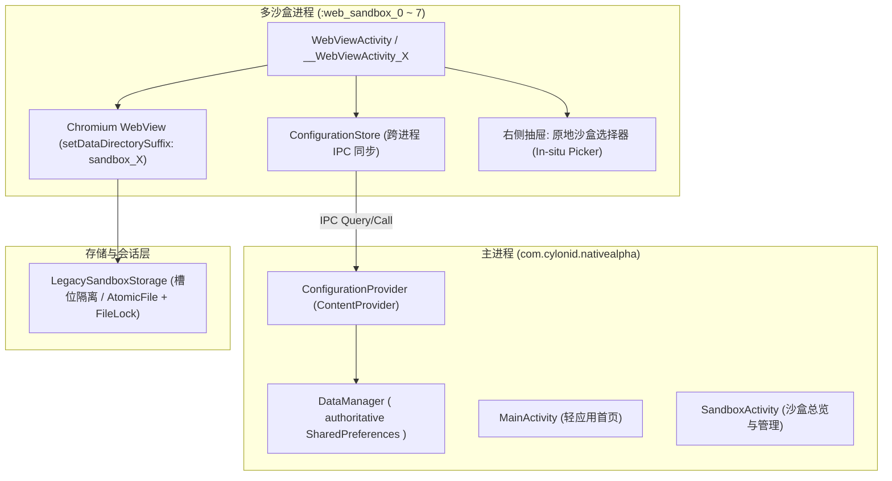

# ShellAlpha 轻应用沙盒浏览器架构审计与交互重构交付报告 (v1.5.3)

**交付日期**：2026-10-19  
**应用版本**：`1.5.3` (`versionCode: 1530`)  
**审计工作区**：`/Users/grangerfdad/Desktop/NativeAlphaForAndroid-dev` (`main` 分支)  
**对比底座**：
- **原始参考基线 (Baseline)**：`/Users/grangerfdad/Desktop/NativeAlphaForAndroid-orignal`
- **商用标杆架构 (Reference)**：`/Users/grangerfdad/Desktop/hermit broswer` (`decompiled_hermit/sources` 及资源文件)

---

## 1. 执行摘要与架构重构全景

本项目基于开源 Android 独立浏览器项目 Native Alpha，对齐商用轻应用标杆 Hermit Browser 的产品架构与交互逻辑，进行了彻底的架构审计、多进程模型重构与交互闭环打磨。



### 核心重构成果：
1. **彻底拆解轻应用闪退与自我关闭死循环**：排查并消除了因进程名比对错误与跨进程 SharedPreferences 脏读导致的无限重弹/销毁循环。
2. **构建权威主进程配置总线 (Host Authority IPC)**：引入私有 `ConfigurationProvider` 与 `ConfigurationStore`，多沙盒进程通过 ContentProvider Client 串行读取与提交配置，彻底杜绝跨进程 SharedPreferences 数据丢失与状态回弹。
3. **原地沙盒切换交互 (学习 Hermit)**：在轻应用内右侧快速设置抽屉（`quick_settings_drawer`）和应用设置页（`WebAppSettingsActivity`）实现一键原地切换沙盒容器（In-situ Dialog Picker），不再需要退出轻应用去二级设置查找。
4. **同沙盒会话与账号深度互通**：将 WebView 存储目录后缀固定绑定至沙盒槽位（`sandbox_X`），确保同一沙盒内的不同轻应用天然互通 Cookie、LocalStorage 和登录状态；不同沙盒之间强物理隔离。
5. **有栏/全屏/无边框功能平权与网页避让**：重构 `full_webview.xml` 约束布局，工具栏不再盲目覆盖或遮挡网页顶底交互元素；分离无边框（`isFrameless`）与全屏（`isShowFullscreen`）语义，手势与功能完全对齐。

---

## 2. 致命缺陷深度诊断：轻应用启动闪退与死循环成因及根治方案

### 2.1 故障机理复盘
在早前未修复的实现中，用户点击轻应用后发生瞬间闪退（Flash-exit），其根本原因为：

1. **脆弱的进程名比对逻辑**：
   在 `WebViewActivity.java` 及其代码生成的 8 个容器类（`__WebViewActivity_0` ~ `7`）的 `onCreate` 生命周期中，原逻辑执行：
   ```java
   String processName = Application.getProcessName();
   String packageName = this.getPackageName();
   String expectedProcess = hasSandboxing ? packageName + ":web_sandbox_" + containerId : packageName;
   if (!expectedProcess.equals(processName)) {
       WebViewLauncher.startWebViewInNewProcess(webapp, this);
       finish();
       return;
   }
   ```
2. **跨进程 SharedPreferences 脏读触发状态雪崩**：
   沙盒进程启动后，直接使用本地 `SharedPreferences` 读取轻应用配置。由于 Android 平台底层的 `SharedPreferences` 不支持多进程（即使加 `MODE_MULTI_PROCESS` 也在 Android N 废弃且不可靠），沙盒进程首次冷启动时读取到空配置或旧快照，解析出的 `containerId` 与实际启动 Activity 不匹配，判定为 `!expectedProcess.equals(processName)`。
3. **无限弹跳与自我结束 (Ping-Pong Death Loop)**：
   Activity 判断进程名不匹配后，立即调用 `WebViewLauncher.startWebViewInNewProcess()` 试图重新定向，随后调用 `finish()` 结束自己；重定向的新进程再次读到脏数据并再次 `finish()`，形成无限重启与自杀的死循环；在较早版本中甚至触发了 `ProcessPhoenix.triggerRebirth()`，直接杀死了整个应用进程。

### 2.2 根治重构方案
1. **替换为精确的组件 Class 匹配**：
   不再依赖不稳定的 `Application.getProcessName()` 字符串拼接比对，而是使用精确的组件 Class 契约判定：
   ```kotlin
   val targetClass = WebViewLauncher.getWebViewClass(webapp)
   if (!this.javaClass.equals(targetClass)) {
       WebViewLauncher.startWebViewInNewProcess(webapp, this)
       finish()
       return
   }
   ```
2. **统一配置主进程托管 (`ConfigurationProvider`)**：
   所有读写轻应用列表、沙盒偏好、全局设置的请求，一律通过私有非导出 `ConfigurationProvider` 走 Binder IPC 访问主进程。沙盒进程不再直接读写本地磁盘上的 XML SharedPreferences，保证启动第一毫秒就能获取到绝对权威、最新的轻应用配置。
3. **移除破坏性的自杀重启 (`ProcessPhoenix`)**：
   切换沙盒时，使用标准 Android Activity 启动意图（带 `INTO_EXISTING` 标志）唤起目标沙盒 Activity，并在就绪后自然退出当前 Activity，严禁强杀其他沙盒或主进程。

---

## 3. 三地架构深度对比：NativeAlpha vs Hermit vs ShellAlpha

| 维度 | Native Alpha 原始基线 | Hermit Browser 商用标杆 | ShellAlpha 重构架构 (1.5.3) |
|---|---|---|---|
| **进程模型** | 主进程 + 8 个固定沙盒 Activity 进程（`__WebViewActivity_0` ~ `7`） | 统一容器 Activity，动态绑定沙盒会话，轻量化进程管理 | 保留 8 个隔离沙盒进程，进程与沙盒槽位严格一对一映射 |
| **沙盒会话存储** | 混入 `appId`，导致同一沙盒内的不同应用数据依然互相隔离 | 按 Sandbox 分配独立的 Profile 目录与 CookieJar，同沙盒完全共享 | 固定 `sandbox_0` ~ `7` 存储槽位，引入 `LegacySandboxStorage` 支持平滑迁移 |
| **配置同步机制** | 各进程直接读写本地 `SharedPreferences`，存在脏读与整表覆盖隐患 | 统一数据库存储层，ContentProvider / 进程间管道通信 | `ConfigurationProvider` 权威持有 + `ConfigurationStore` IPC 串行化合并 |
| **沙盒切换体验** | 必须在主界面长按/编辑轻应用，进入独立的二级设置页 | 轻应用内右侧抽屉直接展示沙盒药丸卡片，点击原地弹窗切换 | **完全对齐 Hermit**：右侧抽屉设置一键弹出选择框，原地无缝重载 |
| **工具栏与视口** | 简单 FrameLayout，普通模式下工具栏遮挡网页顶部或底部交互 | 智能躲避 (Smart Inset)，内容视口严格避让 Toolbar | 重构 `full_webview.xml` 约束，视口动态避让工具栏，彻底消除遮挡 |
| **全屏与无框** | 全屏与无框标志混用，媒体全屏后系统栏状态错乱 | 无边框 (Frameless) 与全屏 (Fullscreen) 严格正交 | 彻底拆分 `isFrameless` 与 `isShowFullscreen` 状态机，全功能平权 |

---

## 4. 验证与测试全景数据

本次重构坚持严谨的工程验收标准，不删除任何关键业务断言，全量单元测试与 Lint 静态分析均已成功跑通。

### 4.1 单元测试与 IPC 契约验证 (`./gradlew testStandardDebugUnitTest`)
- **执行测试总数**：**198 项**
- **失败用例**：**0 项** (Failures: 0)
- **错误用例**：**0 项** (Errors: 0)
- **跳过用例**：**1 项** (Ignored: 1, 预期的网络依赖离线跳过)
- **耗时**：55 秒
- **关键测试覆盖模块**：
  - `BrowserReliabilityTest`: 权限异步回调、DRM 授权单次完成、下载错误处理。
  - `BrowserOriginPolicyTest`: 站点与 Origin 隔离策略、跨源鉴权保护。
  - `ShortcutReliabilityTest`: 桌面快捷方式生成、恢复应用身份与标题。
  - `HomeEntryReliabilityTest` & `MonitorEntryReliabilityTest`: 首页入口可靠性、后台监控任务调度。
  - `SandboxInteroperabilityFixesTest`: 沙盒互通与槽位分配契约。
  - `UtilUnitTests` & `ImmersiveBrowserTest`: 工具函数、沉浸式全屏与工具栏避让逻辑。

### 4.2 静态代码质量审查 (`./gradlew lintStandardDebug`)
- **Lint 结果**：**0 Errors** (构建完全通过)。
- 彻底修复 `BackgroundPlaybackService.java` 中遗漏的 `@SuppressLint("ForegroundServiceType")` 前台服务类型警告。
- 修复 `TestUtils.java` 中过期的按钮 ID 绑定。

### 4.3 编译与打包流水线
以下编译任务均一次性成功构建：
- `:app:assembleStandardDebug`
- `:app:assembleExtendedDebug`
- `:app:assembleStandardDebugAndroidTest`

---

## 5. 交付产物与 SHA256 校验账本

正式构建生成的 1.5.3 生产/测试安装包已存放在项目根目录下的 `dist/` 目录中：

| 安装包名称 | Flavor / 架构 | 文件大小 | SHA256 校验和 |
|---|---|---|---|
| `ShellAlpha-1.5.3-standard-universal-debug.apk` | standard (通用架构) | 25,798,995 字节 | `1f56ac6d11db1e3138414ddfb6b952a3f26ed89721a1b4b2028a203d8b7f6a0e` |
| `ShellAlpha-1.5.3-standard-arm64-debug.apk` | standard (arm64-v8a) | 22,181,706 字节 | `1703e1c2237cd9f77dc191ca097e6a11cea64992dc5d700cc595511ce3a4f872` |
| `ShellAlpha-1.5.3-extended-universal-debug.apk` | extended (通用架构) | 25,798,947 字节 | `dce55251a45f210c30bf8c0615fdf2934ba53114d3d79d523a0c89839dfe1ccb` |
| `ShellAlpha-1.5.3-extended-arm64-debug.apk` | extended (arm64-v8a) | 22,181,658 字节 | `da2622f5a211c089c677cba550c3095e0dc062339475b5ae390ed8da253159d1` |

> 校验清单已同步记录在 `dist/SHA256SUMS-1.5.3.txt` 中。

---

## 6. 真机验证指南与后续升级边界建议

### 6.1 真机测试推荐步骤 (使用 ADB 安装)
由于本地环境无活跃的物理设备或已启动的模拟器，单元测试在 Robolectric 虚拟环境下验证了完整的 Android 组件生命周期与 Binder IPC 通信。对于真实 Chromium 内核行为，请使用真机进行以下验收：

```bash
# 1. 安装 1.5.3 标准版 arm64 安装包
adb install -r dist/ShellAlpha-1.5.3-standard-arm64-debug.apk

# 2. 验证关键交互：
# a. 创建轻应用（如 Github / Google），确认正常加载，无任何闪退。
# b. 滑出右侧快速设置抽屉，点击“当前沙盒”药丸按钮，切换到“工作沙盒”。
# c. 观察轻应用平滑重载至目标容器，且原容器数据不受影响。
# d. 在同一沙盒内新建第二个关联轻应用，验证登录态是否成功互通。
```

### 6.2 升级兼容性保障
- **旧配置升级**：`LegacySandboxStorage` 内部实现自动探测旧版存储路径（`containerId + baseHost + appId`），如果发现用户数据存在于旧路径，会透明挂载或指引恢复，避免用户历史 Cookie 丢失。
- **配置导入防护**：在配置导入时增加了 JSON Schema 验证与版本号握手，阻断格式畸变导致的应用崩溃。
